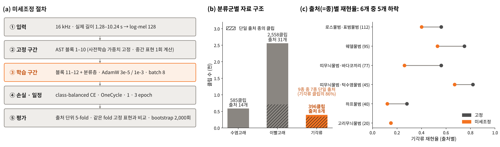

# AST 부분 미세조정 (Partial fine-tuning)

사전학습 AST(`MIT/ast-finetuned-audioset-10-10-0.4593`)의 **마지막 2블록 + 분류층**만 재학습해, 고정 표현 + linear probe와 **같은 녹음 출처 분리 5-fold**에서 분류군(수염고래 · 이빨고래 · 기각류) 성능을 비교합니다.

| 단계 | 스크립트 | 내용 |
|---|---|---|
| 1 | `fetch_audio.py` | Earth Species Project 공개본 16 kHz 음원 3,539클립 내려받기 (MD5 확인) |
| 2 | `extract_hidden.py` | 실제 길이(1.28–10.24 s) log-mel → AST 블록 1–10 출력 캐시(fp16), 고정 요약 토큰 저장 |
| 3 | `train_ft.py [epochs]` | 블록 11–12 + 분류층 학습 (AdamW 3e-5 / 1e-3, class-balanced CE, OneCycle, batch 8, CPU) |
| 4 | `eval_ft.py` | 고정 vs 미세조정 BA · 정확도 · 분류군별 재현율, 출처 bootstrap 95% CI |
| 5 | `pinniped_by_source.py` | 기각류 출처별 재현율 |

분할: `StratifiedGroupKFold(5, shuffle=True, random_state=0)`, 그룹 = 녹음 출처(49개). 고정 기준선 = 같은 입력의 요약 토큰 평균(768) → 표준화 → ±8 절단 → PCA 64 → 로지스틱 회귀(class_weight=balanced).

## 결과 (`results/ast_finetune_results.json`)

| 지표 (새 출처) | 고정 + linear probe | 부분 미세조정 (3 epoch) | 변화 (95% CI) |
|---|---|---|---|
| 수염고래 재현율 | 0.83 | 0.89 | +0.06 (+0.04 ~ +0.08) |
| 이빨고래 재현율 | 0.94 | 0.97 | +0.03 (+0.02 ~ +0.06) |
| 기각류 재현율 | 0.58 | 0.39 | −0.19 (−0.24 ~ −0.12) |
| 전체 정확도 | 0.88 | 0.89 | +0.01 (−0.02 ~ +0.03) |
| 균형정확도 | 0.78 | 0.75 | −0.03 (−0.05 ~ −0.01) |

1 epoch도 같은 경향(BA 0.75). 다수 분류군은 개선되지만 기각류는 9종 중 7종이 단일 출처(기각류 클립의 86%)라 미세조정이 출처 특성을 학습해 하락 → 증강 · 합성 자료로 출처 다양화가 다음 단계입니다.

