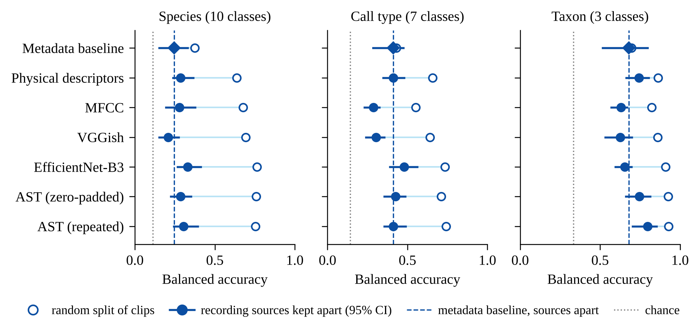
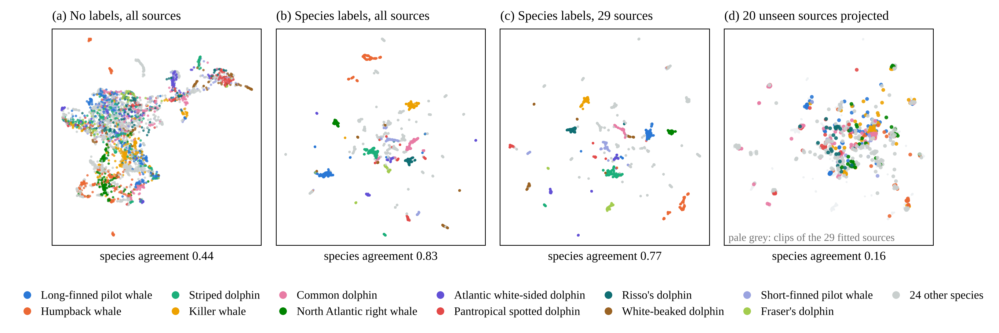
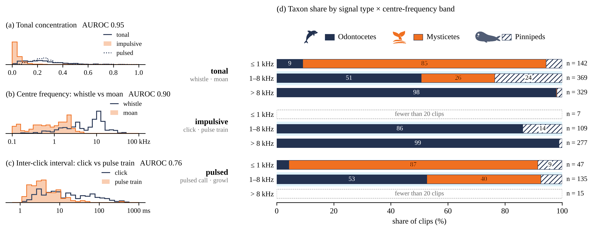
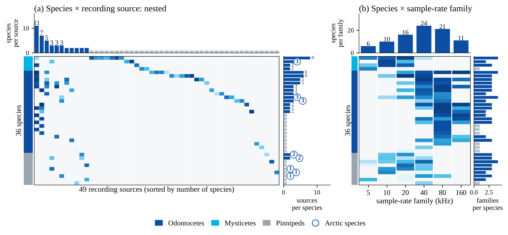

# Marine Mammal Sound Classifier (해양포유류 음향 분류)

수동 소나(Passive Sonar) · 수동 음향 모니터링(PAM) 자료에 공개 AI 레퍼런스 모델을 적용해 **해양포유류 음향 분류 성능을 비교**하고, 녹음 조건이 바뀌어도 유지되는 정보를 바탕으로 **신호 유형 기반 분류기**를 설계한 연구 코드입니다.

> 레퍼런스 비교는 사전학습 가중치를 고정해 수행했고, 별도로 AST 마지막 2블록 부분 미세조정(fine-tuning)을 같은 출처 분리 조건에서 비교했습니다 ([`02_analysis/ast_finetune`](02_analysis/ast_finetune)).

## 한눈에 보기

| 항목 | 내용 |
|---|---|
| 데이터 | Watkins Marine Mammal Sound Database (WHOI), Earth Species Project 공개본 v0.1.0. 13,693클립 → 분석 대상 10,694클립(36종, 녹음 출처 49개) → 표본 3,539클립 |
| 레퍼런스 표현 | AST (Lipari et al. 2026), VGGish (Cominelli et al. 2024), EfficientNet-B3 (Kim et al. 2026), MFCC (Liang et al. 2025), 물리 특징 51개 (본 연구), 메타데이터 기준선(baseline) |
| 분류기 | 동일 선형 분류기(linear probe): 표준화 → PCA ≤ 64 → 로지스틱 회귀 |
| 평가 | 클립 무작위 분할 vs 녹음 출처 단위 분할, 균형정확도(Balanced Accuracy, BA), 출처 bootstrap 95% 신뢰구간 |

## 핵심 결과

- **랜덤 분할에서 선행연구 수준 재현**: 분류군(이빨고래 · 수염고래 · 기각류) BA 0.82–0.93, 종(10종) BA 0.64–0.76. AST · EfficientNet-B3가 가장 높음.
- **출처 분리 시**: 분류군은 AST 0.79로 유지(기준선 0.68). 종 수준은 0.71 → 0.28로 크게 하락하는데, 36종 중 18종이 녹음 출처 1개뿐인 자료 구조 때문이며 다출처 자료로 보완해야 함.
- **부분 미세조정 (AST 블록 11–12)**: 새 출처에서 수염고래 재현율 0.83 → 0.89 (+0.06, 95% CI +0.04~+0.08) · 이빨고래 0.94 → 0.97 (+0.03, CI +0.02~+0.06). 기각류는 9종 중 7종이 단일 출처라 0.58 → 0.39로 하락(트레이드오프) → 증강 · 합성 자료로 보완 필요.
- **녹음 조건에 강건한 정보는 신호 유형 · 대역**: tonal concentration 하나로 impulsive 구분 AUROC 0.95 → 종 대신 *신호 유형 → 측정값 → 분류군 확률* 순서로 판정하는 분류기 설계.

<p align="center"></p>
<p align="center"><sub>표현별 균형정확도: 빈 원 = 클립 무작위 분할, 채운 원 = 녹음 출처 분리(95% CI), 점선 = 메타데이터 기준선</sub></p>

<p align="center"></p>
<p align="center"><sub>VGGish 임베딩 UMAP: 같은 출처 안에서는 종 군집이 뚜렷(분리도 0.83), 미학습 출처를 투영하면 0.16</sub></p>

<p align="center"></p>
<p align="center"><sub>신호 유형 특징의 판별력과 대역별 분류군 비율 → 분류기 설계의 근거</sub></p>

<p align="center"></p>
<p align="center"><sub>데이터 구조: 종이 녹음 출처와 샘플레이트 계열에 묶여 있음(nested)</sub></p>

## 소나 신호처리 관점의 의미

- 공개 DB의 높은 정확도는 **평가 분할 설계**에 따라 크게 달라짐 → 수동 소나 표적 식별 AI도 해역 · 장비 · 녹음 조건을 분리한 시험평가가 필요.
- 생물 소음을 신호 유형으로 먼저 가르는 구조는 수동 소나의 **생물 소음 vs 표적 신호 판별(오경보 저감)** 에 그대로 쓸 수 있음.
- 측면주사 소나(SSS) 기뢰유사물체 탐지 연구 [sss-mine-detection-benchmark](https://github.com/jongchan-joseph-lee/sss-mine-detection-benchmark)(Side B)에서도 같은 평가 원칙을 적용함.

---

## 분석 코드 개요 (Watkins Marine Mammal Sound DB 스크리닝)

Watkins Marine Mammal Sound Database(WHOI)로 보고된 해양포유류 종 분류 성능을 **녹음 비독립성(pseudoreplication)** 과 **녹음 조건 편향(recording bias)** 의 관점에서 다시 평가하고, 녹음 출처가 달라져도 유지되는 정보(신호 유형 · 대역 · 속성)를 찾는 분석 코드입니다.

- 대상: 전체 13,693클립 → 분석 대상 10,694클립(36종, 녹음 출처 49개) → 표본 3,539클립
- 표현: 메타데이터 baseline(샘플레이트 · 클립 길이), 물리 특징 51개, MFCC, VGGish, EfficientNet-B3, AST(모두 가중치 고정)
- 평가: 같은 linear probe(중앙값 대체 → 표준화 → ±8 절단 → PCA ≤ 64 → 로지스틱 회귀, class_weight=balanced)를 클립 랜덤 · 녹음 세션 · 현장 묶음 · 녹음 출처 단위 분할로 비교, 출처 단위 bootstrap 95% CI

### 주요 결과 (자세한 수치는 `results/`)

| 확인한 것 | 결과 |
|---|---|
| 종 10개, 클립 랜덤 → 녹음 출처 분할 | BA 0.62–0.76 → 0.21–0.33 (메타데이터 baseline 0.24) |
| 하락이 일어나는 단위 | 대부분 녹음 세션 단위에서 발생(0.30–0.42). 세션 단위에서는 EffNet-B3 · AST · MFCC가 baseline을 유의하게 넘음 |
| 분류군 (3) | AST가 세션 · 현장 · 출처 모든 단위에서 baseline +0.11–0.16 |
| 신호 유형 3분류, 40 kHz 계열 안 | 0.48–0.69 (baseline 0.34) — 탐색적 |
| Tonal vs Pulsed | 물리 특징 · 펄스 반복률 · 켑스트럼으로도 구분 안 됨 (BA 0.56–0.58 < baseline 0.67) |
| 속성 기반 멀티라벨 판정 | 속성 13개가 물리 특징 51개 · 메타데이터보다 높음 (impulsive 있음 AUROC 0.89) |
| EfficientNet-B3 전처리 복원 | 저장 벡터와 cosine 평균 0.995 (3,539클립) |

### 폴더 구성

| 폴더 | 내용 |
|---|---|
| `01_pipeline_bench/src` | 데이터 구축 · 기준선 파이프라인 `b01`–`b17` (manifest, 녹음 출처 묶기, QC, 물리 특징 `b05`, 사전학습 임베딩 `b06`, 평가 `b07` 등). `wb_notes.py`는 녹음 메모 → 콜 타입 라벨 |
| `01_pipeline_bench/full_cohort` | 10,694클립 전체 분석 · 검토 페이지 스크립트 |
| `02_analysis/ast_finetune` | AST 마지막 2블록 부분 미세조정, 출처 분리 5-fold 비교 · 기각류 출처별 분석 |
| `02_analysis/common_band_4k` | 0–4 kHz 공통 대역 검증 (AST · VGGish · MFCC 재추출) |
| `02_analysis/calltype6` | 콜 타입 6종 linear probe, 혼동 행렬 |
| `02_analysis/signal_type3` | 신호 유형 3분류, 샘플레이트 계열별 평가 |
| `02_analysis/nearest_neighbours` | 최근접 이웃 종 · 출처 일치도 |
| `02_analysis/tonal_vs_pulsed` | 포락선 변조 스펙트럼 · 켑스트럼 피크 특징 시험 |
| `02_analysis/stage1_checks` | 리뷰 지적 검증 1: 종 × fold, 출처 정의 민감도, 메타/음향/둘 다, PCA 유무, 물리 특징 소거, out-of-fold 임계값, A7 재계산 |
| `02_analysis/stage2_checks` | 리뷰 지적 검증 2: Nyquist 결측 처리, band SNR 재정의(최소 통계 잡음), 프레임 단위 속성 · 멀티라벨 판정 |
| `02_analysis/efficientnet_restore` | EfficientNet-B3 전처리 탐색과 복원 스크립트 (`eff_restored.py`) |
| `02_analysis/physical_features` | 물리 특징 재구현 · 검증 |
| `03_web/results_page` | 탭형 결과집 HTML 생성 (지도 · 청취 · probe · 물리 특징 예시) |
| `03_web/cluster_maps` | PCA · t-SNE · UMAP 군집 지도 (로컬 실행용) |
| `03_web/summary_page` | 요약 페이지 |
| `04_figures` | 논문 · 세미나 그림 |
| `05_deck` | 세미나 PPT 생성 · 편집 (pptxgenjs, python-pptx) |
| `06_manuscript` | 원고 docx 생성 |
| `07_references` | 참고문헌 일괄 다운로드 (macOS) |
| `results` | 계산 결과 표(JSON · CSV): reference_v1, 콜 타입 6종, 신호 유형, 공통 대역, 1 · 2단계 점검, 속성 표, 전문가 검증 후보 |
| `tools/set_root.py` | 작업 공간 경로 바꾸기 |

### 실행 준비

```bash
pip install -r requirements.txt
npm install            # PPT · 아이콘 · 스크린샷 스크립트를 쓸 때만
python tools/set_root.py ~/watkins_work   # 스크립트 속 /home/claude/ 를 내 작업 폴더로 바꿈
```

스크립트는 아래 작업 공간 구조를 가정합니다(데이터는 저장소에 포함하지 않음).

```
<ROOT>/
├── audio_core/<cut_id>.flac          # 표본 3,539클립 원음 (원 샘플레이트)
├── pkg_in/data/                      # bench_manifest.csv, core_3539_metadata.csv, main_10694_metadata.csv ...
├── pkg_in/work/features/*.npz        # meta, physv0, mfcc16k, vggish, effb3, ast_tile, ast_zero (3,539행)
├── pkg_in/full_cohort/features/*.npz # 10,694행
├── ref_v1/eval/reference_v1/         # reference_v1 결과 (results.csv, paired.csv, per_class.csv ...)
└── (각 분석 스크립트가 만드는 출력 폴더)
```

`01_pipeline_bench/src`의 `b01` → `b02` → `b04` → `b05` → `b06` → `b07` 순서로 manifest · 특징 · 평가를 다시 만들 수 있습니다.

### 다시 계산하는 예

```bash
python 02_analysis/stage1_checks/repro.py        # 기존 linear probe 재현 확인
python 02_analysis/stage1_checks/run1.py         # 출처 정의별 민감도
python 02_analysis/stage2_checks/phys2.py        # band SNR d0/d1 · Nyquist 결측 · 프레임 속성
python 02_analysis/efficientnet_restore/eff_restored.py   # EfficientNet-B3 복원 전처리로 재추출
```

### 주의

- 콜 타입 라벨은 녹음 메모에서 만든 약한 라벨입니다. 전문가가 검증한 이벤트 정답이 아닙니다.
- 신호 유형 3분류, 속성 기준, 임계값은 결과를 본 뒤 정한 탐색적 기준입니다. 독립 자료에서 고정 후 평가해야 합니다.
- EfficientNet-B3의 원래 전처리 코드는 남아 있지 않아, Kim et al. 2026 공개 코드와 저장 벡터를 대조해 복원했습니다(cosine 0.995).
- 부록 A7(선행연구 절차) 결과의 RF 설정은 원래 실행 코드를 다시 확인하지 못했습니다.
- AST 가중치: `MIT/ast-finetuned-audioset-10-10-0.4593`, revision `f826b80d28226b62986cc218e5cec390b1096902`.

### 데이터와 인용

- Watkins Marine Mammal Sound Database, Woods Hole Oceanographic Institution. 본 분석은 Earth Species Project 공개본 v0.1.0을 사용했습니다. 원음과 메타데이터의 이용 조건은 WHOI 안내를 따르십시오.
- 선행연구: Liang et al. 2025 (Applied Sciences), Cominelli et al. 2024 (Ecology and Evolution), Lipari et al. 2026 (IEEE Access), Kim et al. 2026 (Ecology and Evolution). 전체 목록은 `07_references/download_refs.sh`.
