# Source-Disjoint Marine Mammal Sound Classification Benchmark

Watkins 해양포유류 음향 DB에서 사전학습 오디오 표현의 분류 성능을 녹음 출처 분리(source-disjoint) 조건으로 다시 평가하고, 녹음이 바뀌어도 유지되는 단서로 분류기를 만든 벤치마크

<p align="center">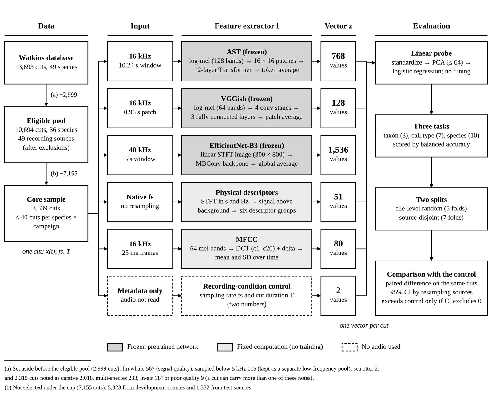</p>

## Background

<p align="center">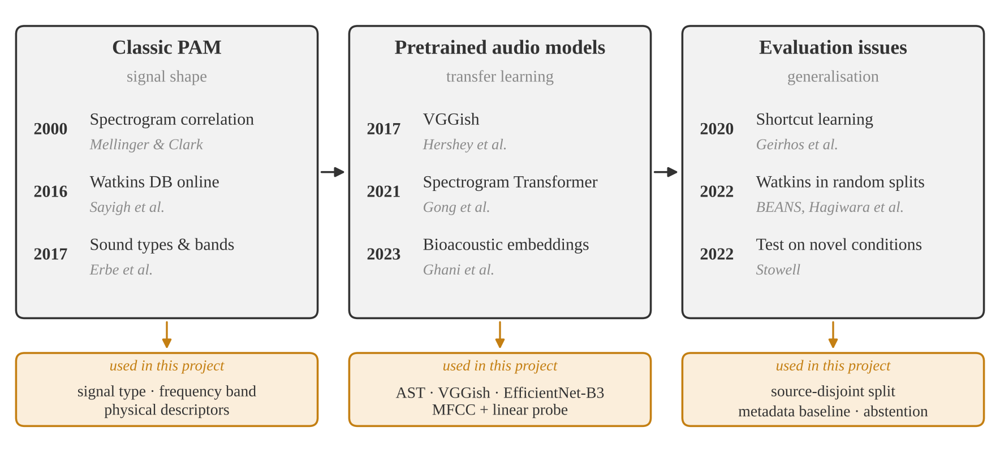</p>


- 해양포유류 수동음향 탐지 · 분류는 스펙트로그램 상관 같은 신호 모양 기반 방법에서 출발함 (Mellinger & Clark, 2000)
- 해양포유류 소리는 tonal · 주파수 변조(FM) · 펄스, 휘슬 · burst-pulse · 클릭 등 신호 유형과 종별 주파수 대역으로 정리됨 (Erbe 등, 2017)
- 최근에는 AST · VGGish 등 사전학습 오디오 표현과 생물음향 전이학습이 주로 쓰임 (Gong 등, 2021; Hershey 등, 2017; Ghani 등, 2023)
- Watkins DB(WHOI; Sayigh 등, 2016)에서 보고된 높은 분류 성능은 대부분 클립 단위 무작위 분할의 결과임
  - BEANS: 무작위 층화 분할 6:2:2, 정확도 0.66–0.87 (Hagiwara 등, 2022)
  - WhaleNet: 층화 분할 75/25, 정확도 97.6% (Licciardi & Carbone, 2024)
- 학습 · 시험을 같은 자료 풀에서 뽑으면 일반화 성능이 과대평가되므로 새 조건에서 시험해야 함 (Stowell, 2022)

## Benchmark Setup

| 항목 | 내용 |
|---|---|
| 자료 | Watkins (WHOI), Earth Species Project 공개본 v0.1.0 · 10,694 클립 (36종, 녹음 출처 49개) → 평가 3,539 클립 |
| 표현 | AST · VGGish · EfficientNet-B3 · MFCC · 물리 특징 51개 + linear probe |
| 기준선 | 오디오 없이 샘플레이트 · 길이만 쓴 메타데이터 분류기 |
| 분할 | 클립 무작위 분할 vs 녹음 출처 분리 (지역 + 연도 단위) |
| 과제 | 종 (10) · 콜 타입 (7) · 분류군 (3) |
| MVP | 신호 유형 → 분류군 2단 분류기, 클립별 물리량 14개, 신뢰도 기반 검토 위임 |
| 지표 | 균형정확도(balanced accuracy, BA) |

## Results

| 비교 | 결과 |
|---|---|
| 무작위 분할 vs 녹음 출처 분리 (종) | BA 0.64–0.76 → 0.21–0.33 |
| 메타데이터 기준선 (종, 출처 분리) | BA 0.24 |
| 분류군 (출처 분리) | BA 0.63–0.80 |
| MVP: 신호 유형 → 분류군 | BA 0.75 (AST 0.75–0.80, 물리 특징 51개 0.74) |
| MVP 검토 위임 (하위 30%) | 나머지 70% BA 0.80 |

### 무작위 분할 vs 녹음 출처 분리

<p align="center">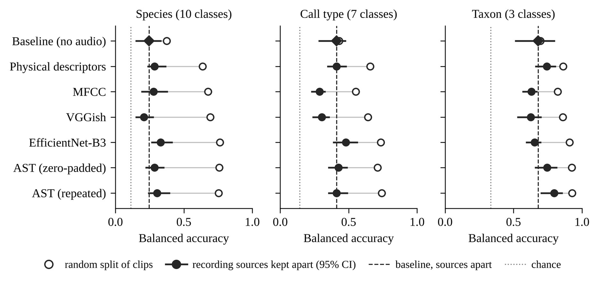</p>

| Balanced accuracy | 무작위 분할 | 녹음 출처 분리 |
|---|---|---|
| 종 (10) | 0.64–0.76 | 0.21–0.33 (기준선 0.24) |
| 콜 타입 (7) | 0.55–0.74 | 0.29–0.48 |
| 분류군 (3) | 0.82–0.93 | 0.63–0.80 |

- AST 부분 미세조정: 전체 BA 0.784 → 0.752. 수염고래 · 이빨고래 재현율은 오르고 기각류는 내려감 ([결과](results/ast_finetune_results.json))

<details>
<summary>임베딩 분포 (UMAP · t-SNE) · 특징 추출 예시</summary>

<p align="center">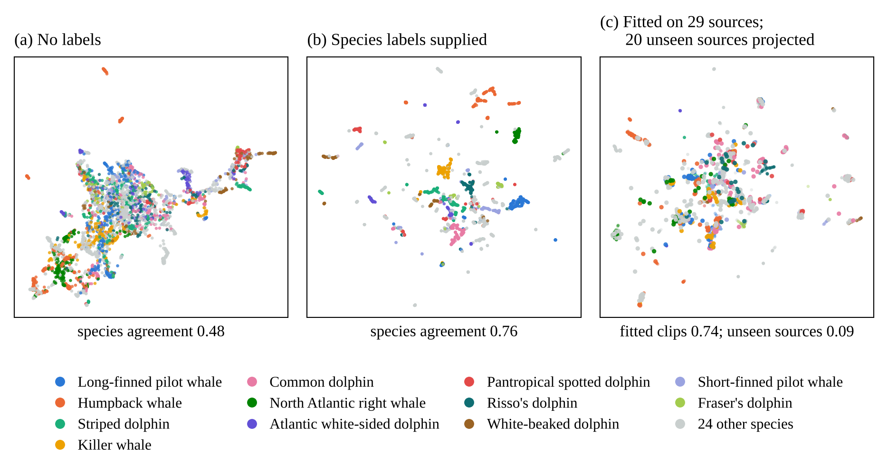</p>
<p align="center"><sub>VGGish 표현 UMAP (3,539 클립)</sub></p>

<p align="center">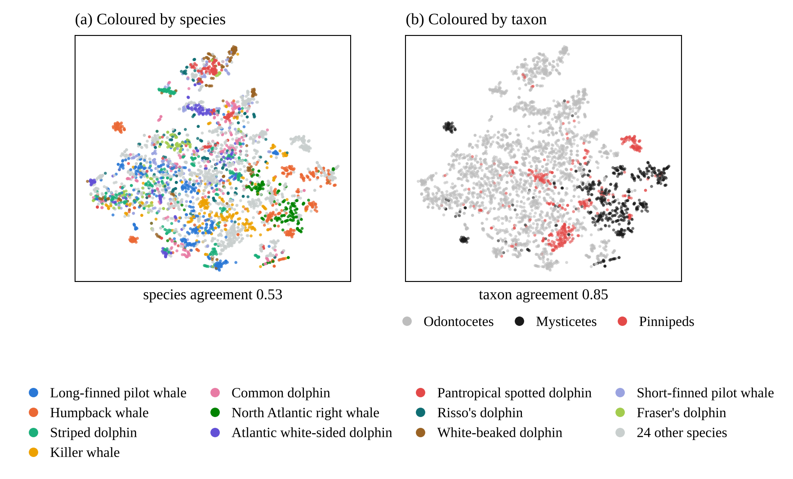</p>
<p align="center"><sub>VGGish 표현 t-SNE — 종별 색, 분류군별 색</sub></p>

<p align="center">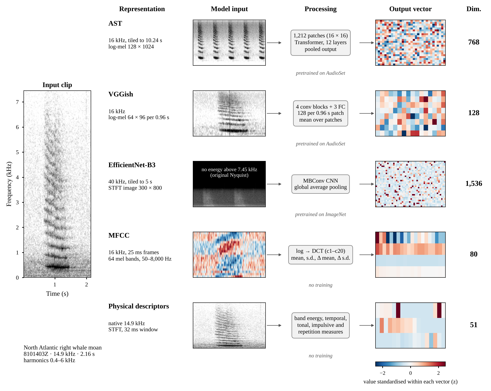</p>
<p align="center"><sub>북대서양긴수염고래 moan 클립 1개의 입력, 처리 구조, 출력 벡터</sub></p>

</details>

### 신호 유형 · 주파수 대역

<p align="center">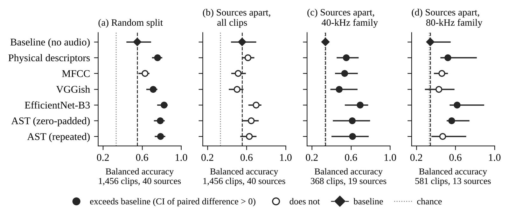</p>
<p align="center"><sub>신호 유형(tonal · impulsive · pulsed) 3분류 균형정확도 (탐색적)</sub></p>

- 녹음 출처가 달라져도 신호 유형과 주파수 대역 기준의 구분은 유지됨 (탐색적 분석)

<details>
<summary>물리량 · 주파수 대역별 구성</summary>

<p align="center">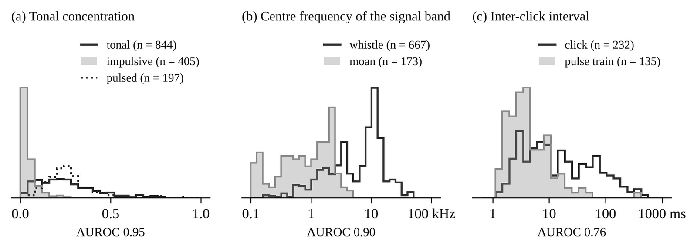</p>
<p align="center"><sub>단일 물리량 분포 (탐색적)</sub></p>

<p align="center">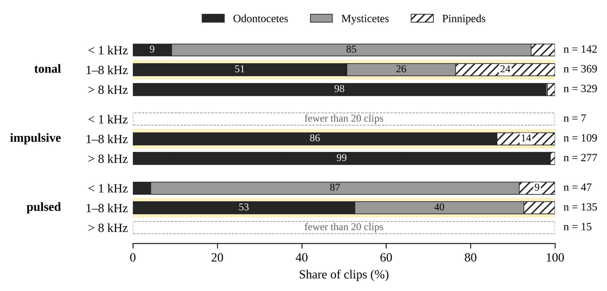</p>
<p align="center"><sub>신호 유형 × 주파수 대역별 분류군 구성 (탐색적)</sub></p>

</details>

### MVP: 신호 유형 → 분류군 분류기

<p align="center">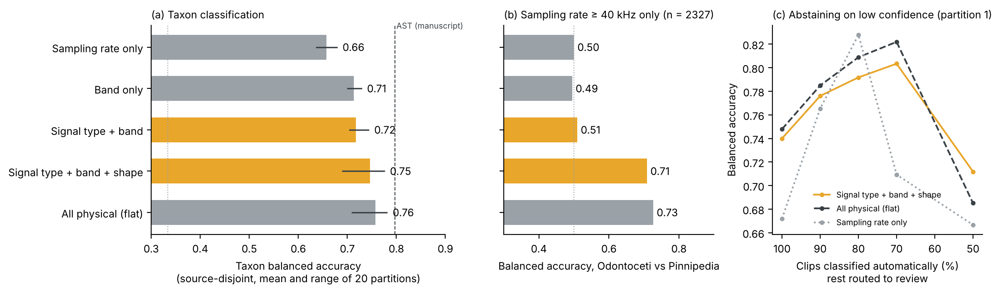</p>

| 분류군 BA, 녹음 출처 분리 | 전체 (3,539 클립) | fs ≥ 40 kHz, 이빨고래 vs 기각류 |
|---|---|---|
| 샘플레이트만 | 0.66 | 0.50 |
| 주파수 대역만 | 0.71 | 0.49 |
| 신호 유형 + 대역 | 0.72 | 0.51 |
| 신호 유형 + 대역 + 모양 물리량 | 0.75 | 0.71 |
| 물리량 전체, 단일 단계 | 0.76 | 0.73 |

- 출처 7-fold를 20회 다른 분할로 반복한 평균. 같은 과제에서 AST 0.75–0.80, 물리 특징 51개 0.74 (분할 방식은 같고 fold 배정은 다름)
- 샘플레이트를 40 kHz 이상으로 맞추면 주파수 대역은 구분력이 없고, 모양 물리량(임펄스 비율 · 반복 간격 · 조화성)이 구분을 유지함
- 샘플레이트 기준선 대비 +0.07, 출처 단위 부트스트랩 95% 구간 −0.04–0.18 (0 포함)
- 결과 수치: [`results/mvp_signal_type_first.json`](results/mvp_signal_type_first.json)

## Takeaways

- 종 단위 분류의 높은 성능\
  → 녹음 조건(샘플레이트 · 길이)에 기댄 결과. 출처를 분리하면 메타데이터 기준선 수준 (지름길 학습, Geirhos 등, 2020)
- 녹음이 바뀌어도 유지되는 단위\
  → 신호 유형과 분류군. 소리 분류 체계(Erbe 등, 2017)와 일치
- 주석(annotation) 보조 도구로서의 MVP\
  → 신호 유형을 중간 결과로 내고, 신뢰도 낮은 클립을 사람 검토로 넘김 (선택적 분류, Geifman & El-Yaniv, 2017)

## Limitations → Next Steps

- Watkins 내부 평가 (외부 자료 · 연속 녹음 미포함)\
  → 외부 PAM 자료와 연속 녹음으로 검증
- 녹음 출처를 메타데이터(지역 + 연도)로 정한 근사 단위\
  → 녹음 장비 · 세션 정보가 있는 자료로 출처 단위 재정의
- 신호 유형 분석은 첫 결과 이후 정의한 탐색적 분석\
  → 신호 유형 기준을 미리 고정한 새 자료에서 재평가
- MVP 개선폭의 95% 구간이 0을 포함\
  → 출처 수 · 클립 수를 늘리고 물리량 보강
- 클립 단위 물리량 사용, 연속 녹음의 신호 구간 검출 미포함\
  → 신호 구간 검출 → 신호 유형 → 분류군 순서의 실시간 주석 파이프라인으로 확장

## References

- Erbe, C. 등 (2017). Review of underwater and in-air sounds emitted by Australian and Antarctic marine mammals. *Acoustics Australia*, 45(2), 179–241.
- Geifman, Y., & El-Yaniv, R. (2017). Selective classification for deep neural networks. *NeurIPS 2017*. [arXiv:1705.08500](https://arxiv.org/abs/1705.08500)
- Geirhos, R. 등 (2020). Shortcut learning in deep neural networks. *Nature Machine Intelligence*, 2, 665–673.
- Ghani, B. 등 (2023). Global birdsong embeddings enable superior transfer learning for bioacoustic classification. *Scientific Reports*, 13. [doi:10.1038/s41598-023-49989-z](https://doi.org/10.1038/s41598-023-49989-z)
- Gong, Y., Chung, Y.-A., & Glass, J. (2021). AST: Audio spectrogram transformer. *Interspeech 2021*.
- Hagiwara, M. 등 (2022). BEANS: The benchmark of animal sounds. [arXiv:2210.12300](https://arxiv.org/abs/2210.12300)
- Hershey, S. 등 (2017). CNN architectures for large-scale audio classification. *ICASSP 2017*.
- Licciardi, A., & Carbone, D. (2024). WhaleNet: A novel deep learning architecture for marine mammals vocalizations on Watkins Marine Mammal Sound Database. [arXiv:2402.17775](https://arxiv.org/abs/2402.17775)
- Mellinger, D. K., & Clark, C. W. (2000). Recognizing transient low-frequency whale sounds by spectrogram correlation. *Journal of the Acoustical Society of America*, 107(6).
- Sayigh, L. 등 (2016). The Watkins Marine Mammal Sound Database: An online, freely accessible resource. *Proceedings of Meetings on Acoustics*.
- Stowell, D. (2022). Computational bioacoustics with deep learning: A review and roadmap. *PeerJ*, 10, e13152.

## Dataset

- [Watkins Marine Mammal Sound Database](https://whoicf2.whoi.edu/science/B/whalesounds/index.cfm) (Woods Hole Oceanographic Institution), Earth Species Project 공개본 v0.1.0
- 10,694 클립 (36종, 녹음 출처 49개) → 평가 표본 3,539 클립
- 원음은 저장소에 포함하지 않음

<details>
<summary>자료 구조</summary>

<p align="center">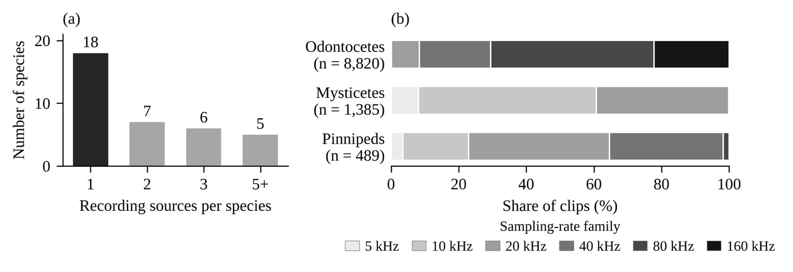</p>
<p align="center"><sub>종별 녹음 출처 수, 분류군별 샘플레이트 구성</sub></p>

</details>

## Getting Started

```bash
pip install -r requirements.txt
python tools/set_root.py ~/watkins_work   # 작업 경로 설정
```

- 파이프라인 순서: `01_pipeline_bench/src`의 `b01` → `b02` → `b04` → `b05` → `b06` → `b07`

## Reproduce

| 결과 | 스크립트 | 출력 |
|---|---|---|
| 무작위 분할 vs 녹음 출처 분리 BA | `01_pipeline_bench/src/b07_evaluate.py` | `results/reference_v1_results.csv` (`filecv` = 무작위, `allcv` = 녹음 출처 분리) |
| 신호 유형 3분류 | `02_analysis/signal_type3/eval3.py` | `results/signal_type3_regroup3.json` |
| AST 부분 미세조정 | `02_analysis/ast_finetune/eval_ft.py` | `results/ast_finetune_results.json` |
| MVP | `05_mvp/signal_type_first.py`, `05_mvp/fig_mvp.py` | `results/mvp_signal_type_first.json`, `docs/figures/fig8_mvp.png` |
| 그림 2–7 | `04_figures/figs.py` | `docs/figures/` |

- MVP는 저장소에 포함된 `results/attributes_3539.csv`만으로 실행되며 원음이 필요 없음

## Project Structure

| 폴더 | 내용 |
|---|---|
| `01_pipeline_bench` | 자료 구축, 특징 추출, 평가 파이프라인 |
| `02_analysis` | 미세조정, 신호 유형 분석, 최근접 이웃, 점검 스크립트 |
| `03_web` · `04_figures` | 결과 열람 HTML, 그림 생성 |
| `05_mvp` | 신호 유형 우선 분류기 (MVP) |
| `results` | 결과 수치 (JSON · CSV) |
| `docs` | 그림 |

## License

코드는 MIT License를 따름. Watkins 원음 · 메타데이터와 사전학습 가중치는 각 원 조건을 따름.
