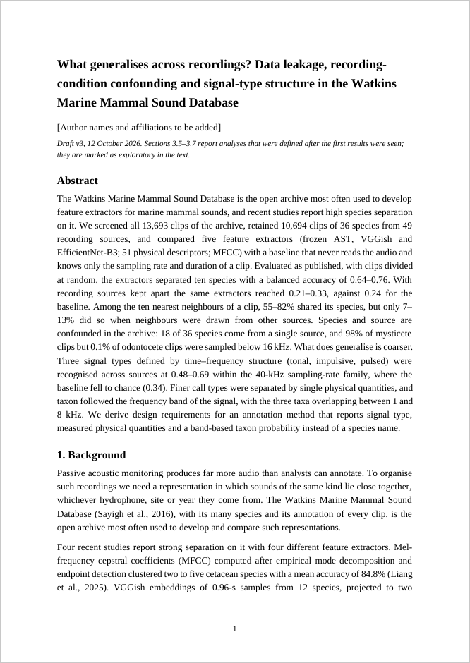

# What generalises across recordings? — Watkins 해양포유류 음향 DB의 레퍼런스 표현 평가

Watkins Marine Mammal Sound Database에서 공개 음향 표현(AST · VGGish · EfficientNet-B3 · 물리 특징 · MFCC)이 보고한 높은 종 분리 성능이 **녹음 출처를 분리한 평가에서도 유지되는지**, 그리고 **어떤 수준의 정보가 출처를 넘어 일반화되는지**를 검토한 개인 연구입니다. 이 저장소는 논문 원고 초안의 코드와 결과 수치를 담고 있습니다.

| | |
|---|---|
| **원고** | *What generalises across recordings? Data leakage, recording-condition confounding and signal-type structure in the Watkins Marine Mammal Sound Database* — 초안 v3 (2026-10-12), 투고 전 |
| **자료** | Watkins DB (WHOI), Earth Species Project 공개본 v0.1.0 — 13,693 클립 → 선별 10,694 클립(36종, 녹음 출처 49개) → 표본 3,539 클립 |
| **평가** | 고정 표현 + linear probe, 클립 무작위 분할 vs 녹음 출처 분리, 오디오를 읽지 않는 기준선(샘플레이트 · 길이), 출처 단위 재표본 95% 신뢰구간 |
| **검증 범위** | Watkins DB 내부 정량 평가까지. 독립 외부 자료 · 연속 녹음 · 비생물 신호 · 실해역 운용은 다루지 않음 |

## 1. 연구 배경

Watkins DB는 해양포유류 음향 표현을 개발 · 비교할 때 가장 자주 쓰이는 공개 아카이브이며, 최근 연구들은 이 DB에서 높은 종 분리 성능을 보고했습니다(Liang et al. 2025, MFCC 군집 정확도 84.8%; Cominelli et al. 2024, VGGish UMAP; Lipari et al. 2026, AST 종 정확도 92.4%; Kim et al. 2026, EfficientNet-B3 탐지 F 0.82–1.00).

이 DB에는 결과 해석을 어렵게 하는 두 가지 구조가 있습니다.

- **같은 녹음의 클립이 학습 · 시험에 함께 들어갈 수 있음** — 한 종의 클립이 소수의 녹음 이벤트에서 잘려 나온 경우가 많아, 클립을 무작위로 나누면 같은 녹음이 양쪽에 들어가는 데이터 누수(data leakage)가 생길 수 있습니다.
- **녹음 조건이 라벨과 얽혀 있음** — 녹음마다 대상 종에 맞춘 샘플레이트로 디지털화되어, 분류기가 소리 대신 녹음 조건으로 정답을 맞힐 수 있습니다(shortcut learning).

또한 실제 수동음향 모니터링 도구는 종보다 신호 유형(click · whistle · moan 등) 단위로 구성되는 경우가 많아, 종 대신 더 거친 수준의 기술(記述)이 일반화의 단위가 될 수 있는지도 함께 확인했습니다.

**연구 질문**
1. 공개 표현들은 각 연구의 평가 방식에서 라벨을 분리하는가?
2. 녹음 출처를 분리하면 그 분리가 얼마나 남으며, 오디오를 읽지 않는 기준선보다 높은가?
3. 녹음 조건을 통제한 뒤 남는 것은 무엇인가 — 어떤 라벨 수준이 출처를 넘어 인식되고, 어떤 물리량이 이를 담는가?

## 2. 연구 구조

<p align="center"></p>
<p align="center"><sub>원고 Figure 1 — 자료 선별, 표현 추출기, 평가 구조</sub></p>

### 단계별 수행 범위

| 단계 | 내용 | 수행 범위 | 근거 |
|---|---|---|---|
| 1. 자료 선별 | 수질 · 녹음 환경(수조 · 공기 중 · 다종 혼재) 기준 제외, 녹음 출처(지역 + 연도) 정의 | 수행 | [`01_pipeline_bench/src`](01_pipeline_bench/src) `b01`–`b04` |
| 2. 표현 추출 | 고정 AST · VGGish · EfficientNet-B3, 물리 특징 51개, MFCC, 녹음 조건 기준선 | 수행 | `b05`, `b06` |
| 3. 분류 평가 | 표준화 → PCA(≤64) → 로지스틱 회귀, 과제: 분류군(3) · 콜 타입(7) · 종(10) | 수행 | `b07`, [`results/reference_v1_results.csv`](results/reference_v1_results.csv) |
| 4. 분할 비교 | 클립 무작위 5-fold vs 녹음 출처 분리 7-fold, 출처 단위 재표본 신뢰구간 | 수행 | 같은 결과 파일 |
| 5. 이웃 · 투영 진단 | 10-최근접 이웃의 라벨 일치율, UMAP 투영 | 수행 (난수 seed 1개, 신뢰구간 없음) | [`02_analysis/nearest_neighbours`](02_analysis/nearest_neighbours) |
| 6. 신호 유형 · 물리량 · 주파수 대역 | 3개 신호 유형, 단일 물리량 판별력, 대역별 분류군 구성 | **탐색적** (첫 결과를 본 뒤 정의) | [`02_analysis/signal_type3`](02_analysis/signal_type3), [`results/`](results) |
| 7. 독립 자료 · 연속 녹음 검증 | 다른 아카이브에서 신호 유형 정의 고정 후 평가 | 미수행 (후속 단계) | — |

## 3. 결과 요약

| 질문 | 관찰 결과 (원고 기준) |
|---|---|
| 무작위 분할에서의 분리 | 종 10개 균형정확도(BA) 0.64–0.76. 각 선행연구 방식의 평가에서도 보고치와 비슷한 수준의 분리가 재현됨 |
| 녹음 출처 분리 시 | 종 BA 0.21–0.33으로 하락(우연 0.10), 오디오를 읽지 않는 기준선 0.24와 비슷한 수준. 콜 타입 0.55–0.74 → 0.29–0.48, 분류군 0.82–0.93 → 0.63–0.80 |
| 이웃 구조 | 클립의 10-최근접 이웃 중 같은 종 비율 55–82%, 다른 출처에서만 이웃을 고르면 7–13%(우연 3%, 기준선 10%) |
| DB 구조 | 36종 중 18종이 단일 녹음 출처, 수염고래 클립의 98%가 16 kHz 미만 샘플레이트(이빨고래 0.1%) |
| 출처를 넘어 남는 것 (탐색적) | 40 kHz 샘플레이트 계열 안에서 신호 유형 3분류(tonal · impulsive · pulsed) BA 0.48–0.69, 기준선 0.34(우연 수준) |
| 물리량과 대역 (탐색적) | 학습 없이 단일 물리량으로 비교: tonal vs impulsive AUROC 0.95(음조 집중도), whistle vs moan 0.90(대역 중심주파수, 샘플레이트 단독 0.96이라 교란 남음), click vs pulse train 0.76(클릭 간격). 신호 대역 8 kHz 초과는 98–100% 이빨고래, 1 kHz 미만 tonal · pulsed는 85–87% 수염고래, 1–8 kHz에서 세 분류군이 겹침 |

<p align="center"></p>
<p align="center"><sub>원고 Figure 3 — 표현별 균형정확도. 빈 원: 클립 무작위 분할, 채운 원: 녹음 출처 분리(95% 신뢰구간), 점선: 출처 분리 기준선</sub></p>

**해석 범위**
- 이 DB에서 클립 무작위 분할 점수는 **소리 자체보다 같은 녹음을 다시 알아보는 능력**을 상당 부분 반영하는 것으로 보입니다. 이는 특정 표현의 결함이 아니라 아카이브 구조와 분할 방식의 성질입니다.
- 종 이름보다 **신호 유형과 주파수 대역** 수준이 출처를 넘어 더 안정적으로 관찰되었습니다. 다만 3.5–3.7절의 분석은 첫 결과를 본 뒤 정의한 탐색적 분석이며, 확인에 쓸 미사용 자료가 남아 있지 않습니다.
- 원고는 이 관찰로부터 *신호 구간 검출 → 물리량 측정 → 신호 유형 · 대역 기반 분류군 확률* 구조의 설계 요건을 제안합니다. 이 구조는 **구현 · 검증하지 않은 제안**입니다.

<details>
<summary><b>원고 그림 더 보기</b> — 자료 구조 · UMAP · 신호 유형 · 물리량 · 대역</summary>

<p align="center"></p>
<p align="center"><sub>Figure 2 — (a) 종별 녹음 출처 수, (b) 분류군별 샘플레이트 계열 구성</sub></p>

<p align="center"></p>
<p align="center"><sub>Figure 4 — VGGish 표현의 UMAP. (c) 미학습 출처 투영 시 종 회복 BA 0.16</sub></p>

<p align="center"></p>
<p align="center"><sub>Figure 5 — 신호 유형 3분류 균형정확도 (탐색적)</sub></p>

<p align="center"></p>
<p align="center"><sub>Figure 6 — 단일 물리량 분포 (분류기 미사용, 탐색적)</sub></p>

<p align="center"></p>
<p align="center"><sub>Figure 7 — 신호 유형 × 주파수 대역별 분류군 구성 (탐색적)</sub></p>

</details>

## 4. 논문 원고



**What generalises across recordings? Data leakage, recording-condition confounding and signal-type structure in the Watkins Marine Mammal Sound Database**

- 초안 v3, 2026-10-12 · 저장소에는 첫 페이지 미리보기만 공개합니다. 원고 전문은 저자에게 요청해 주십시오.
- 구성: 1 Background → 2 Materials and Methods → 3 Results (3.1–3.7) → 4 Discussion (설계 요건, 한계와 다음 단계)
- 3.5–3.7절은 첫 결과를 본 뒤 정의한 탐색적 분석으로 원고에 표시되어 있습니다.
- 이 저장소의 코드와 [`results/`](results)의 수치가 원고의 근거입니다.
- 투고 전 초안입니다. 저자 · 소속은 추가 예정이며, 인용 · 활용 시 저자에게 문의해 주십시오.

<br clear="right">

## 5. 원고 이후 추가 분석 (원고 미포함)

**AST 부분 미세조정.** 같은 3,539 클립 · 49 출처를 녹음 출처 분리 5-fold로 나누고, AST 블록 11–12 · 최종 정규화층 · 분류층을 3 epoch 학습해 고정 표현 + linear probe와 비교했습니다.

| 지표 | 고정 표현 + linear probe | 부분 미세조정 | 변화 (95% CI) |
|---|---|---|---|
| 전체 균형정확도 | 0.784 | 0.752 | −0.032 (−0.051 ~ −0.008) |
| 수염고래 재현율 | 0.827 | 0.889 | +0.062 (+0.037 ~ +0.084) |
| 이빨고래 재현율 | 0.942 | 0.973 | +0.030 (+0.021 ~ +0.055) |
| 기각류 재현율 | 0.583 | 0.394 | −0.189 (−0.241 ~ −0.122) |

- 고래류 두 분류군의 재현율은 올랐지만 전체 균형정확도는 내려갔습니다. 따라서 **전체 성능 개선이 아니라 분류군 간 성능 변화**로 해석합니다.
- 기각류는 9종 중 7종이 단일 출처(기각류 클립의 약 86%)입니다. 출처 편향이 하락의 직접 원인인지는 별도 실험이 필요합니다.
- 이 비교의 고정 표현 기준선(0.784, 5-fold)은 원고의 분류군 결과(AST 반복 채움 0.797, 7-fold)와 입력 · 분할이 다른 별도 실험입니다.
- 근거: [`results/ast_finetune_results.json`](results/ast_finetune_results.json), [평가 코드](02_analysis/ast_finetune/eval_ft.py)

## 6. 한계

- 평가 대상은 Watkins DB의 해양포유류 클립(중앙값 1.9초)입니다. 연속 녹음의 이벤트 탐지, 비생물 신호와의 구분, 실해역 운용 성능은 다루지 않았습니다.
- 녹음 출처는 메타데이터(지역 + 연도)로 만든 근사 단위이며, 검증된 세션 · 개체 단위가 아닙니다.
- 출처 분리는 DB 내부 일반화 평가입니다. 독립 외부 자료에 대한 일반화를 보장하지 않습니다.
- 콜 타입 라벨은 녹음 메모에서 만든 약한 라벨이며, 전문가가 검증한 이벤트 정답이 아닙니다.
- 신호 유형 3분류와 임계값은 결과를 본 뒤 정한 기준입니다. 독립 자료에서 고정 후 다시 평가해야 합니다.
- EfficientNet-B3의 원 전처리 코드는 남아 있지 않아 공개 코드와 저장 벡터를 대조해 복원했습니다(코사인 유사도 0.995).

<details>
<summary><b>재현 방법과 저장소 구성</b></summary>

```bash
pip install -r requirements.txt
python tools/set_root.py ~/watkins_work   # 스크립트의 작업 경로를 내 폴더로 바꿈
```

자료는 저장소에 포함하지 않습니다. 스크립트는 아래 작업 공간 구조를 가정합니다.

```
<ROOT>/
├── audio_core/<cut_id>.flac          # 표본 3,539 클립 원음 (원 샘플레이트)
├── pkg_in/data/                      # bench_manifest.csv, core_3539_metadata.csv, main_10694_metadata.csv ...
├── pkg_in/work/features/*.npz        # meta, physv0, mfcc16k, vggish, effb3, ast_tile, ast_zero (3,539행)
├── pkg_in/full_cohort/features/*.npz # 10,694행
└── ref_v1/eval/reference_v1/         # reference_v1 결과
```

- 자료 구축 → 특징 → 평가: `01_pipeline_bench/src`의 `b01` → `b02` → `b04` → `b05` → `b06` → `b07`
- 재계산 예: `python 02_analysis/stage1_checks/repro.py` (linear probe 재현 확인), `python 02_analysis/stage1_checks/run1.py` (출처 정의별 민감도)

| 폴더 | 내용 |
|---|---|
| `01_pipeline_bench` | 자료 구축 · 기준선 파이프라인 (`b01`–`b17`), 10,694 클립 전체 분석 |
| `02_analysis` | 미세조정, 공통 대역(0–4 kHz) 검증, 콜 타입 · 신호 유형, 최근접 이웃, 점검 스크립트 |
| `03_web` | 결과 열람용 HTML 생성 |
| `04_figures` | 원고 그림 생성 |
| `results` | 계산 결과 표 (JSON · CSV) |
| `docs` | README 그림 (원고 그림), 원고 첫 페이지 미리보기 |

</details>

## 데이터와 인용

- Watkins Marine Mammal Sound Database, Woods Hole Oceanographic Institution. Earth Species Project 공개본 v0.1.0 사용. 원음과 메타데이터의 이용 조건은 WHOI 안내를 따릅니다.
- 선행연구: Liang et al. 2025 (*Applied Sciences*), Cominelli et al. 2024 (*Ecology and Evolution*), Lipari et al. 2026 (*IEEE Access*), Kim et al. 2026 (*Ecology and Evolution*). 전체 목록은 원고 참고문헌.
- AST 가중치: `MIT/ast-finetuned-audioset-10-10-0.4593`, revision `f826b80d28226b62986cc218e5cec390b1096902`.

## 관련 저장소

- [sss-mine-detection-benchmark](https://github.com/jongchan-joseph-lee/sss-mine-detection-benchmark) — 측면주사 소나 공개 영상의 기뢰유사물체 탐지 · 분류 평가
- [sas_signal_processing](https://github.com/jongchan-joseph-lee/sas_signal_processing) — 공개 합성 SAS 원시 신호의 영상 형성 · 검증

## 라이선스

코드는 MIT License를 따릅니다 ([`LICENSE`](LICENSE)). Watkins DB 원음 · 메타데이터와 사전학습 가중치는 저장소에 포함하지 않으며 각 원 조건을 따릅니다. [`docs/manuscript/`](docs/manuscript)의 원고 초안과 원고 그림은 이 라이선스에 포함되지 않습니다.
