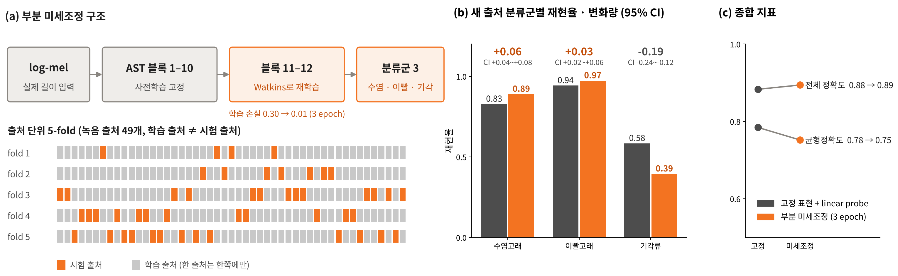

# Side A · PAM — 해양포유류 음향 분류 레퍼런스 모델 벤치마크

> **PAM AI 벤치마크:** Watkins 3,539 클립 · 36종 · 녹음 출처 49개, 공개 레퍼런스 표현 5종 비교 및 녹음 출처 분리 평가

Watkins Marine Mammal Sound Database에 공개 AI 레퍼런스 표현(AST · VGGish · EfficientNet-B3 · MFCC · 물리 특징 51개)을 같은 조건으로 적용해 분류 성능을 비교하고, **녹음 출처를 분리했을 때 성능이 얼마나 유지되는지**와 **어떤 수준의 정보(신호 유형 · 물리량 · 분류군)가 출처를 넘어 일반화되는지**를 검토한 개인 연구입니다.

| | |
|---|---|
| **상태** | 분석 완료 · 논문 원고 초안 v3 ([PDF](docs/manuscript/Watkins_manuscript_v3_draft.pdf)) |
| **데이터** | Watkins DB (WHOI), Earth Species Project 공개본 v0.1.0 — 13,693 → 10,694 클립(36종, 출처 49개) → 표본 3,539 클립 |
| **평가** | 동일 linear probe, 클립 무작위 5-fold vs **녹음 출처 분리** 7-fold, 메타데이터 기준선(샘플레이트 · 길이), 출처 단위 bootstrap 95% CI |
| **검증 등급** | 공개 DB 내 정량 평가 (실해역 · 비생물 표적 · 소나 오경보 미검증) |

## 핵심 결과

| 결과 | 수치 | 의미 |
|---|---|---|
| 분류군(이빨고래 · 수염고래 · 기각류), 출처 분리 | AST BA **0.797** (메타데이터 기준선 0.680) | 출처가 바뀌어도 분류군 수준은 기준선을 넘어 유지 |
| AST 부분 미세조정, 출처 분리 5-fold | 이빨고래 재현율 **0.942 → 0.973**, 수염고래 **0.827 → 0.889** | 고래류 재현율 상승 (기각류 하락으로 전체 BA는 0.784 → 0.752) |
| 신호 유형(tonal · impulsive · pulsed), 출처 분리 · 40 kHz 계열 | BA **0.48–0.69** (기준선 0.34) | 종 대신 신호 유형 수준에서 일반화 (탐색적) |
| impulsive 판별 단일 특징, 미학습 출처 | out-of-fold BA **0.867** | 물리량 하나로 신호 유형 구분 가능 (탐색적) |
| 종 10개, 무작위 → 출처 분리 | BA 0.64–0.76 → **0.21–0.33** (기준선 0.24) | 종 단위 성능의 상당 부분은 녹음 조건에 의존 → 평가 설계 우선 |

## 상세 결과

### 고정 표현 레퍼런스 비교

- **클립 무작위 분할**: 분류군(이빨고래 · 수염고래 · 기각류) BA **0.82–0.93**, 종(10종) BA **0.64–0.76**. AST · EfficientNet-B3가 상위 성능을 보였습니다. 선행연구에서 사용한 표현을 참고한 비교이며, 각 논문의 학습 · 분할 절차 전체를 동일하게 재현한 결과는 아닙니다.
- **녹음 출처 분리**: 분류군은 AST(`ast_tile`) BA **0.797**(메타데이터 기준선 **0.680**). 종 10개에서는 음향 표현별 BA가 **0.21–0.33**으로 하락합니다. 예를 들어 AST(`ast_zero`)는 클립 무작위 분할 **0.759 → 출처 분리 0.286**입니다. [표본 라벨표](02_analysis/ast_finetune/labels_3539.csv)에서도 확인되는 36종 중 18종의 단일 녹음 출처 구조와 함께 해석해야 하며, 종 10개 평가는 조건을 만족하는 부분집합(1,664클립 · 36출처)입니다.
- **신호 유형 · 속성 탐색**: tonal concentration으로 impulsive(click · pulse train)와 나머지 유형(whistle · moan · pulsed call · growl)을 구분한 단일 특징 AUROC는 **0.954**입니다(유효 1,446클립의 분포 비교). 별도로 학습 출처에서 임계값을 정해 미학습 출처에 적용한 out-of-fold BA는 **0.867**입니다([결과의 `F_thresholds`](results/stage1_meta_acoustic_pca_ablation_thresholds.json), [코드](02_analysis/stage1_checks/run2.py)). 속성 13개를 이용한 약한 라벨 기반 출처 분리 평가에서는 `impulsive 있음` AUROC **0.894**를 얻었습니다([결과](results/stage2_attribute_presence.json)). 모두 DB 내 탐색적 유형 분석이며, 이를 바탕으로 제안한 *신호 유형 → 측정 속성 · 대역 → 분류군 확률* 구조 전체의 연계 성능은 후속 검증 대상입니다.

레퍼런스 비교 수치의 근거는 [`results/reference_v1_results.csv`](results/reference_v1_results.csv)입니다. `subset=all`, `metric=balanced_acc`, `protocol=filecv/allcv`와 해당 `task`, `feature` 행에서 확인할 수 있습니다.

### AST 부분 미세조정: 개별 분류군 개선과 전체 BA 하락

동일한 **3,539클립 · 49출처**를 녹음 출처 분리 5-fold로 평가했습니다. AST 블록 11–12 · 최종 정규화층 · 분류층을 3 epoch 학습하고, 같은 입력의 고정 AST 표현 + linear probe와 비교한 결과입니다. 아래 전체 지표는 각 클립의 out-of-fold 예측을 합쳐 계산했습니다.

| 지표 | 고정 표현 + linear probe | 부분 미세조정 | 변화 (95% CI) |
|---|---|---|---|
| **전체 균형정확도 (BA)** | **0.784** | **0.752** | **−0.032 (−0.051 ~ −0.008)** |
| 전체 정확도 | 0.883 | 0.894 | +0.011 (−0.021 ~ +0.034) |
| 수염고래 재현율 | 0.827 | 0.889 | +0.062 (+0.037 ~ +0.084) |
| 이빨고래 재현율 | 0.942 | 0.973 | +0.030 (+0.021 ~ +0.055) |
| 기각류 재현율 | 0.583 | 0.394 | −0.189 (−0.241 ~ −0.122) |

근거: [`results/ast_finetune_results.json`](results/ast_finetune_results.json)의 `frozen`, `finetune`, `recall_frozen`, `recall_ft`, `acc_*`, `ci_diff`, `d_*` 및 [평가 코드](02_analysis/ast_finetune/eval_ft.py). 변화의 점추정치는 각 지표의 차이이며, 95% CI는 녹음 출처 단위 bootstrap 2,000회로 계산했습니다.

**고래류 두 분류군의 재현율은 상승했지만, 세 분류군을 같은 비중으로 평가하는 BA는 하락했습니다.** 따라서 이 결과는 전체 분류 성능 개선이 아니라 분류군 간 성능 변화로 해석합니다. 전체 정확도는 이빨고래가 많은 표본 구성(수염고래 585 · 이빨고래 2,558 · 기각류 396클립)의 영향을 받으며, 정확도 변화의 신뢰구간은 0을 포함합니다.

기각류는 9종 중 7종이 단일 출처이며, 이 7종이 기각류 클립의 약 86%를 차지합니다([표본 라벨표](02_analysis/ast_finetune/labels_3539.csv)). [출처별 재현율](results/ast_finetune_pinniped_by_source.json)도 함께 분석했으나, 출처 편향이 성능 하락의 직접 원인인지는 별도 실험이 필요합니다. 다출처 자료 확보, 증강 · 합성 자료 활용은 후속 검증 방향입니다.

레퍼런스 비교의 `ast_tile`은 10.24초 반복 채움 · 창 평균과 출처 분리 7-fold를 사용하고, 이 미세조정 비교는 1.28–10.24초 입력과 출처 분리 5-fold를 사용합니다. 따라서 위 BA 0.797과 미세조정 기준선 0.784는 서로 다른 설정의 결과입니다([표현 추출](01_pipeline_bench/src/b06_embed_pretrained.py), [미세조정 입력](02_analysis/ast_finetune/ast_core.py)).

<p align="center"></p>
<p align="center"><sub>출처 분리 5-fold: 고래류 재현율 상승, 기각류 재현율 및 전체 균형정확도 하락</sub></p>

<p align="center"></p>
<p align="center"><sub>표현별 균형정확도: 빈 원 = 클립 무작위 분할, 채운 원 = 녹음 출처 분리(95% CI), 점선 = 메타데이터 기준선</sub></p>

<p align="center"></p>
<p align="center"><sub>VGGish UMAP의 종 일치도 0.83, 미학습 출처 투영 시 0.16 (종 라벨을 활용한 시각화 진단)</sub></p>

<p align="center"></p>
<p align="center"><sub>Watkins DB 내 탐색적 신호 유형 특징 분석과 대역별 분류군 비율 → 처리 구조 제안의 근거</sub></p>

<p align="center"></p>
<p align="center"><sub>데이터 구조: 종이 녹음 출처와 샘플레이트 계열에 묶여 있음(nested)</sub></p>

### 분석별 결과 요약

| 확인한 것 | 결과 |
|---|---|
| 종 10개, 클립 랜덤 → 녹음 출처 분할 | BA 0.64–0.76 → 0.21–0.33 (출처 분리 메타데이터 baseline 0.24). [레퍼런스 결과](results/reference_v1_results.csv) |
| 하락이 일어나는 단위 | 세션 분리만으로 종 BA가 0.30–0.42로 하락. 세션 단위에서는 EffNet-B3 · AST · MFCC의 baseline 대비 차이의 95% CI가 0보다 큼. [분할 민감도 결과](results/stage1_species_fold_and_split_sensitivity.json) |
| 분류군 (3) | AST의 세션 · 현장 · 출처 분할 점추정치가 baseline 대비 +0.11–0.16. [분할 민감도 결과](results/stage1_species_fold_and_split_sensitivity.json) |
| 신호 유형 3분류, 40 kHz 샘플레이트 계열 평가 부분집합 | 출처 분리 BA 0.48–0.69 (baseline 0.34). 학습은 전체 계열, 평가만 부분집합 — 탐색적. [결과](results/signal_type3_regroup3.json) |
| Tonal vs Pulsed | 물리 특징 · 펄스 반복률 · 켑스트럼 비교에서 기준선을 넘지 못함 (BA 0.56–0.58 < baseline 0.67). [평가 코드](02_analysis/tonal_vs_pulsed/eval.py) |
| 속성 기반 멀티라벨 판정 | impulsive 있음 AUROC: 속성 13개 0.894, 물리 특징 51개 0.865, 메타데이터 0.814. [약한 라벨 기반 결과](results/stage2_attribute_presence.json) |
| EfficientNet-B3 전처리 복원 | 저장 벡터와 cosine 평균 0.995 (3,539클립) |

## 논문 원고

**What generalises across recordings? Data leakage, recording-condition confounding and signal-type structure in the Watkins Marine Mammal Sound Database** — 초안 v3 (2026-10-12)

- 원고: [docs/manuscript/Watkins_manuscript_v3_draft.pdf](docs/manuscript/Watkins_manuscript_v3_draft.pdf)
- 이 저장소의 코드와 [`results/`](results) 수치가 원고의 근거입니다. 원고 3.5–3.7절은 첫 결과를 본 뒤 정의한 탐색적 분석으로 표시되어 있습니다.
- 투고 전 초안입니다. 저자 · 소속은 추가 예정이며, 인용 · 활용 시 저자에게 문의해 주십시오.

## 소나 신호처리 적용 방향 (제안 · 미검증 범위)

- **평가 방법의 활용**: 출처 분할, 메타데이터 기준선, 분류군별 성능 · 신뢰구간을 함께 보는 방법은 소나 AI 시험평가 설계에 참고할 수 있습니다. 본 연구에서 출처가 달라질 때 성능이 어떻게 바뀌는지를 정량적으로 확인했습니다.
- **처리 구조의 확장 가능성**: 신호 유형과 측정 속성을 먼저 분석하는 구조를 생물 소음 분류 또는 소나 후보 신호의 보조 특징으로 검토할 수 있습니다. 다만 현재 모델과 수치는 Watkins DB의 해양포유류 분류에 해당하며, **비생물 표적과의 구분 성능 · 오경보 저감 효과를 입증하지 않습니다.**
- **다음 검증 단계**: 비생물 표적, 선박 · 환경 소음, 생물·비생물 혼합 신호를 포함한 별도 자료에서 학습 · 시험하고, 해역 · 장비 · 녹음 조건을 분리해 재현율 · 오경보율을 평가해야 합니다. 단계적 처리 구조와 실시간 적용은 연계 성능 · 처리 지연 검증을 거쳐야 합니다.
- 측면주사 소나 연구 [Side B · SSS](https://github.com/jongchan-joseph-lee/sss-mine-detection-benchmark)에서도 중복 자료 관리와 평가 분할에 따른 성능 차이를 분석했습니다.

## 실행

```bash
pip install -r requirements.txt
npm install            # PPT · 아이콘 · 스크린샷 스크립트를 쓸 때만
python tools/set_root.py ~/watkins_work   # 스크립트 속 /home/claude/ 를 내 작업 폴더로 바꿈
```

스크립트는 아래 작업 공간 구조를 가정합니다(데이터는 저장소에 포함하지 않음).

```
<ROOT>/
├── audio_core/<cut_id>.flac          # 표본 3,539클립 원음 (원 샘플레이트)
├── pkg_in/data/                      # bench_manifest.csv, core_3539_metadata.csv, main_10694_metadata.csv ...
├── pkg_in/work/features/*.npz        # meta, physv0, mfcc16k, vggish, effb3, ast_tile, ast_zero (3,539행)
├── pkg_in/full_cohort/features/*.npz # 10,694행
├── ref_v1/eval/reference_v1/         # reference_v1 결과 (results.csv, paired.csv, per_class.csv ...)
└── (각 분석 스크립트가 만드는 출력 폴더)
```

`01_pipeline_bench/src`의 `b01` → `b02` → `b04` → `b05` → `b06` → `b07` 순서로 manifest · 특징 · 평가를 다시 만들 수 있습니다.

다시 계산하는 예:

```bash
python 02_analysis/stage1_checks/repro.py        # 기존 linear probe 재현 확인
python 02_analysis/stage1_checks/run1.py         # 출처 정의별 민감도
python 02_analysis/stage2_checks/phys2.py        # band SNR d0/d1 · Nyquist 결측 · 프레임 속성
python 02_analysis/efficientnet_restore/eff_restored.py   # EfficientNet-B3 복원 전처리로 재추출
```

<details>
<summary><b>저장소 구성</b></summary>

| 폴더 | 내용 |
|---|---|
| `01_pipeline_bench/src` | 데이터 구축 · 기준선 파이프라인 `b01`–`b17` (manifest, 녹음 출처 묶기, QC, 물리 특징 `b05`, 사전학습 임베딩 `b06`, 평가 `b07` 등). `wb_notes.py`는 녹음 메모 → 콜 타입 라벨 |
| `01_pipeline_bench/full_cohort` | 10,694클립 전체 분석 · 검토 페이지 스크립트 |
| `02_analysis/ast_finetune` | AST 마지막 2블록 부분 미세조정, 출처 분리 5-fold 비교 · 기각류 출처별 분석 |
| `02_analysis/common_band_4k` | 0–4 kHz 공통 대역 검증 (AST · VGGish · MFCC 재추출) |
| `02_analysis/calltype6` | 콜 타입 6종 linear probe, 혼동 행렬 |
| `02_analysis/signal_type3` | 신호 유형 3분류, 샘플레이트 계열별 평가 |
| `02_analysis/nearest_neighbours` | 최근접 이웃 종 · 출처 일치도 |
| `02_analysis/tonal_vs_pulsed` | 포락선 변조 스펙트럼 · 켑스트럼 피크 특징 시험 |
| `02_analysis/stage1_checks` | 리뷰 지적 검증 1: 종 × fold, 출처 정의 민감도, 메타/음향/둘 다, PCA 유무, 물리 특징 소거, out-of-fold 임계값, A7 재계산 |
| `02_analysis/stage2_checks` | 리뷰 지적 검증 2: Nyquist 결측 처리, band SNR 재정의(최소 통계 잡음), 프레임 단위 속성 · 멀티라벨 판정 |
| `02_analysis/efficientnet_restore` | EfficientNet-B3 전처리 탐색과 복원 스크립트 (`eff_restored.py`) |
| `02_analysis/physical_features` | 물리 특징 재구현 · 검증 |
| `03_web/results_page` | 탭형 결과집 HTML 생성 (지도 · 청취 · probe · 물리 특징 예시) |
| `03_web/cluster_maps` | PCA · t-SNE · UMAP 군집 지도 (로컬 실행용) |
| `03_web/summary_page` | 요약 페이지 |
| `04_figures` | 논문 · 세미나 그림 |
| `05_deck` | 세미나 PPT 생성 · 편집 (pptxgenjs, python-pptx) |
| `06_manuscript` | 원고 docx 생성 |
| `07_references` | 참고문헌 일괄 다운로드 (macOS) |
| `results` | 계산 결과 표(JSON · CSV): reference_v1, 콜 타입 6종, 신호 유형, 공통 대역, 1 · 2단계 점검, 속성 표, 전문가 검증 후보 |
| `tools/set_root.py` | 작업 공간 경로 바꾸기 |

</details>

## 한계

- 평가는 Watkins DB의 해양포유류 음향 클립을 대상으로 했습니다. 비생물 표적과의 구분, 연속 녹음에서의 이벤트 탐지, 실제 소나 오경보율 · 실해역 운용 성능은 검증하지 않았습니다.
- 녹음 출처 단위 분리는 DB 내 일반화 평가입니다. 독립 외부 DB나 모든 해역 · 장비 조건에 대한 일반화를 보장하지 않습니다.
- AST 미세조정은 고래류 재현율 상승과 함께 기각류 재현율 · 전체 BA 하락을 보였습니다. 증강 · 합성 자료나 단계적 처리 구조의 개선 효과는 후속 검증 대상입니다.
- 콜 타입 라벨은 녹음 메모에서 만든 약한 라벨입니다. 전문가가 검증한 이벤트 정답이 아닙니다.
- 신호 유형 3분류, 속성 기준, 임계값은 결과를 본 뒤 정한 탐색적 기준입니다. 독립 자료에서 고정 후 평가해야 합니다.
- EfficientNet-B3의 원래 전처리 코드는 남아 있지 않아, Kim et al. 2026 공개 코드와 저장 벡터를 대조해 복원했습니다(cosine 0.995).
- 부록 A7(선행연구 절차) 결과의 RF 설정은 원래 실행 코드를 다시 확인하지 못했습니다.
- AST 가중치: `MIT/ast-finetuned-audioset-10-10-0.4593`, revision `f826b80d28226b62986cc218e5cec390b1096902`.

## 관련 저장소

| | 저장소 | 내용 |
|---|---|---|
| **Side A · PAM** | marine-mammal-classifier-benchmark (현재) | 해양포유류 음향 분류 레퍼런스 모델 벤치마크 |
| **Side B · SSS** | [sss-mine-detection-benchmark](https://github.com/jongchan-joseph-lee/sss-mine-detection-benchmark) | 측면주사 소나 기뢰유사물체 탐지 · 분류 벤치마크 |
| **Side C · SAS** | [SAS_signal_processing](https://github.com/jongchan-joseph-lee/SAS_signal_processing) | 공개 합성 SAS 원시 신호 처리 · 영상 형성 검증 |

## 데이터와 인용

- Watkins Marine Mammal Sound Database, Woods Hole Oceanographic Institution. 본 분석은 Earth Species Project 공개본 v0.1.0을 사용했습니다. 원음과 메타데이터의 이용 조건은 WHOI 안내를 따르십시오.
- 선행연구: Liang et al. 2025 (Applied Sciences), Cominelli et al. 2024 (Ecology and Evolution), Lipari et al. 2026 (IEEE Access), Kim et al. 2026 (Ecology and Evolution). 전체 목록은 `07_references/download_refs.sh`.
